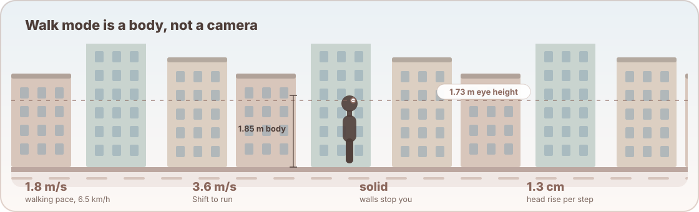
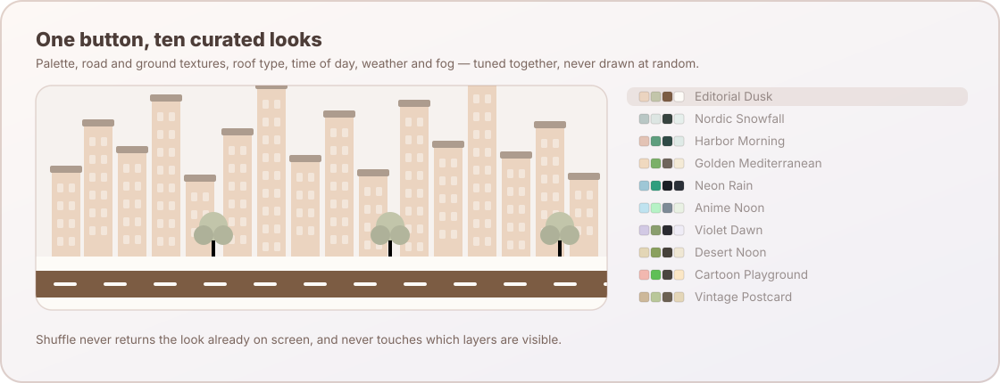

<p align="center">
  
</p>

<h1 align="center">3D OSM Model</h1>

<p align="center">
  <strong>One click from QGIS to an interactive OpenStreetMap city.</strong>
</p>

<p align="center">
  Search a place or select an area, download live OSM data, and open a Three.js 3D city viewer with procedural buildings, roads, sidewalks, water, trees, street furniture, traffic, pedestrians, and optional DEM terrain. Export it as images, video or a GLB model for Blender, Rhino and SketchUp.
</p>

<p align="center">
  <a href="metadata.txt"></a>
  <a href="LICENSE"></a>
  <a href="https://geophilo.com/osm_3d_model/"></a>
  
  
</p>

<p align="center">
  <a href="#quick-start">Quick start</a> |
  <a href="#where-your-runs-are-kept">Your runs</a> |
  <a href="#viewer-experience">Viewer</a> |
  <a href="#what-is-sent-where">What is sent where</a> |
  <a href="docs/SHOWCASE.md">Showcase</a> |
  <a href="docs/ARCHITECTURE.md">Architecture</a> |
  <a href="https://geophilo.com/osm_3d_model/manual.html">Manual</a>
</p>

---

## 📖 Documentation

The **[reference manual](https://geophilo.com/osm_3d_model/manual.html)** covers the dialog, the viewer and its settings. Bugs and requests go to [GitHub issues](https://github.com/YusufEminoglu/osm_3d_model/issues).

## The Product Promise

3D OSM Model turns a small planning study area into a live, navigable city model without asking the user to prepare a 3D dataset first. It is designed for urban planners, educators, students, local governments, mobility teams, and anyone who needs a fast spatial story from OpenStreetMap.

The plugin keeps the workflow deliberately simple:

1. Search a place by name, or use the current map view or selected polygon features in QGIS.
2. Choose a boundary shape — inscribed circle, rounded rectangle, rectangle, or the exact polygon. The boundary is drawn on the map before anything is downloaded, and the area is capped at your maximum study area (at most 300 ha).
3. It downloads OSM buildings, roads, cycleways, waterways, water areas (lakes, ponds, riverbanks), greens, car parks, pedestrian squares, trees, bus stops, benches, lamps, and bins.
4. It writes them to a GeoPackage in a new folder for the run and adds them to the project as a styled layer group, with native-tag GeoJSON layers and a manifest for the viewer.
5. It opens the city in a browser viewer served from your own computer, the viewer shared with 3D City Studio.

<p align="center">
  
</p>

## Quick Start

### Install

In QGIS, open **Plugins > Manage and Install Plugins**, search for **3D OSM Model** and install it. It runs on QGIS 3.28 and later, QGIS 4 included.

For development, point QGIS at the folder that holds your clone of this repository:

```powershell
$env:QGIS_PLUGINPATH = "C:\path\to\folder-containing-osm_3d_model"
```

Restart QGIS, enable **3D OSM Model**, then open the plugin from the toolbar or plugin menu.

### Run the bundled sample viewer

The repository ships with a small sample city so the viewer is never empty. From the repository folder:

```powershell
py -3 -m http.server 8120 --bind 127.0.0.1 --directory web
```

Open:

```text
http://127.0.0.1:8120/src/
```

### Use it inside QGIS

1. Open **3D OSM Model** from the toolbar. Under **Find a place**, type a town, a neighbourhood or an address, press Enter or **Search**, and pick one of up to five matches; the map centres on it, wide enough for the largest boundary. You can also zoom the map to your area yourself, or select polygon feature(s) in the active layer.
2. Choose the boundary shape and the map and web theme. The boundary is drawn on the map while the dialog is open, and the readout gives its shape and area, so you see what will be built before anything is downloaded.
3. Optionally, under **Advanced**, pick a DEM raster, or a basemap layer to drape under the city.
4. Click **Create OSM layers & export 3D viewer**. The status line names the OpenStreetMap server being asked and counts the seconds, and **Cancel** stops the download within two seconds. Closing the dialog or pressing Esc only hides it: the build continues, and the toolbar icon brings the dialog back.
5. When the build is done, the summary lists what was built, how many trees come from OpenStreetMap and how many the plugin planted, how many building heights are estimated, where the data came from, and every problem, such as a DEM or basemap that could not be used. The city opens in your browser unless you untick **Open the 3D viewer automatically after export**.

On an empty project, **Add OSM basemap to the map** adds the OpenStreetMap tile layer to navigate with; when no basemap is chosen yet, it is also offered as the underlay beneath the 3D city. A map view wider than 50 km is refused with a hint: zoom in to a neighbourhood, or search a place.

## Where Your Runs Are Kept

Every run is kept in its own folder inside your QGIS profile:

```text
<QGIS profile folder>/osm_3d_model/runs/<YYYYmmdd-HHMMSS>/
```

The folder is named after the date and time of the run. QGIS shows the profile folder under **Settings > User Profiles > Open Active Profile Folder**. A run folder holds the layers in a GeoPackage, `layers.gpkg`, and, under `data/`, what the viewer reads: the GeoJSON layers, the manifest, and the DEM and basemap image when you chose them and they could be used.

- The layers in QGIS load from that GeoPackage, so they come back when you save and reopen the project, and updating the plugin does not touch them.
- **Open data folder** (under **Advanced**, and in the summary) opens the folder of the last run, and **Reopen last viewer** opens its city again. Before your first run, that button reads **Open sample city** and opens the small city that ships with the plugin, and **Open data folder** opens the `runs` folder.
- Nothing is deleted automatically. **Delete old runs**, under **Advanced**, asks first and then removes the older run folders. It keeps the newest run, every run that a layer of the open project reads from and, on Windows, any run with a file open in another program. It cannot see projects that are not open, so keep the runs your other projects use, or save their layers elsewhere first.

Up to 1.9.1 the export went into the plugin's own folder (`web/data`), was replaced by every run and deleted by a plugin update, and the QGIS layers were temporary.

## What Is Real and What Is Estimated

The footprints, streets, water and greens are OpenStreetMap's. Part of the third dimension is not, and the plugin says which part:

- **Building heights.** OSM `height` includes the roof, so for a building tagged with `height` and a roof rise (see below), the rise is taken off the walls, never leaving less than 2 m of wall, and walls and roof together keep the tagged height. A building with `height` but no roof tags at all gets walls of the full height, and the viewer draws its default roof on top. One tagged with `building:levels` gets 3 m per level, a half level rounding up. One with neither gets a default number of floors for its type: 2 for a house, 4 for apartments, 5 for an office, 1 for a warehouse, 3 when the type is unknown. Each building's `height_source` attribute (`height`, `levels` or `default`) says which rule applied, and the run summary counts the estimated heights.
- **Roofs and raised parts.** `roof:height`, or `roof:levels` × 3 m, sets the roof rise. A building with `height` and a pitched `roof:shape` but neither of those gets a rise of 3 m, or 0.3 × its height when that is less. Without any of these the viewer draws its default roof. `min_height`, or `building:min_level` × 3 m, lifts the walls off the ground, as for a building part over a passage.
- **Trees.** OpenStreetMap trees stand where they are mapped. Parks, woods, gardens, cemeteries and other green areas are rarely mapped tree by tree, so the plugin plants trees inside them, at most 130 per area and 500 per run, in the same places every time. Each tree's `source` attribute says `osm` or `planted`, and the run summary counts the two separately.
- **Illustration.** Facades, roof shapes where OSM gives none, cars, cyclists and pedestrians are generated for the picture, not taken from data.

## Why It Matters

| Need | How the plugin helps |
| --- | --- |
| Fast urban context | Builds a 3D model directly from OSM without manual layer preparation. |
| Planning communication | Turns a map view into screenshots, walk-throughs, measurements, and live stakeholder demos. |
| Mobility reading | Separates car-capable roads, cycleways, sidewalks, pedestrians, cyclists, and traffic. |
| Public realm detail | Adds trees, water, benches, bus stops, street lamps, and bins when OSM contains them. |
| Terrain context | Uses an optional DEM while falling back gracefully to a clean flat base. |
| Global portability | Keeps native OSM tags such as `building`, `building_levels`, `highway`, `waterway`, `landuse`, and `width`. |
| Design hand-off | Saves the city as a GLB model for Blender, Rhino and SketchUp. |

## Signature Features


### One-button OSM to 3D

The plugin handles the place search, the Overpass download, clipping, reprojection, the GeoPackage and GeoJSON export, manifest creation, local server startup, and browser launch in one flow.

### Study area, your shape

Pick how the study boundary is derived from the map view or a selected polygon, then let the plugin clamp it to a polite maximum request size:

| Boundary shape | What you get |
| --- | --- |
| **Inscribed circle** | The largest circle that fits inside the area — the classic, clean look (default). |
| **Rounded rectangle** | The bounding box with generously rounded corners. |
| **Rectangle (extent)** | The bounding box, kept tidy — corners are softened just slightly on the base. |
| **Exact polygon** | The selected polygon used as-is (falls back to the rectangle of the map view). |

Whatever shape you choose, the model base extends 5 m beyond the boundary with softly rounded corners, so the city always sits on a small, presentation-ready platform. OSM data stays clipped to the inner boundary; only the platform uses the wider ring.

### Easy colour themes

Pick a **Map & web theme** in the dialog to style both the native QGIS layer group and exported 3D city. QGIS receives categorized buildings and ground uses, hierarchy-aware metric road widths, coordinated water/trees/furniture, and a presentation base beneath the data. The browser theme recolours the **content only** — never the viewer toolbar or panels.

| Theme | Mood |
| --- | --- |
| **Editorial Paper** | Warm ivory paper, brown hierarchy roads, muted greens and elegant building pastels (default). |
| **Plugin tones** | Salmon and warm grey — the original signature look. |
| **Tinted gray + teal** | Cool neutral greys with teal accents. |
| **Teal + salmon** | Deep teal streets against a warm salmon base. |
| **Light purple + soft black** | Light lavender base with near-black roads. |
| **Warm sand + slate** | Warm sand platform with slate roofs and roads. |
| **Anime** | Bright cel-shaded pastels on a light ground. |
| **Cartoon** | Bold primary colours over dark roads. |
| **Pixar** | Warm, friendly creams and oranges. |
| **Futuristic** | Dark neon base with cyan and violet glass towers. |
| **Classic era** | Vintage sepia stone with terracotta tile roofs. |

The chosen theme travels with the export and is applied automatically when the viewer opens. Re-opening the same export keeps any manual colour edits you made in the Style dock.

Building walls follow **Style > Facades**. In the default, *Auto by function*,
each building gets a facade from its OSM function and height: offices, shops,
civic buildings and industry get the dynamic facade of their type, and the
other buildings mostly wear the six apartment photo facades, low ones mostly
villas. Dynamic facades draw windows, frames, sills, shutters, balconies,
shopfronts and entrances on a whole number of window bays per wall, so windows
are never cut by a corner and rows sit on the real floors, and at night a
share of their windows is lit. *Function styles* uses the facade chosen per
function in the Style dock instead, and a facade attribute on a building
always wins.

### Walk mode, from a real body

<p align="center">
  
</p>

Walk mode is lived from inside a body rather than flown as a low camera. Every
vertical dimension derives from one setting — the walker's stature, **1.85 m** by
default — using standard anthropometry:

| Quantity | Value at 1.85 m | Source |
| --- | --- | --- |
| Standing eye height | 1.73 m | 0.936 × stature |
| Crouched eye height | 1.11 m | 0.60 × stature |
| Walking pace | 1.8 m/s · 6.5 km/h | a brisk walk |
| Run (Shift) | 3.6 m/s · 13.0 km/h | |
| Stride | one step per 0.78 m | drives the head movement |

Buildings are solid — each horizontal axis is resolved separately, so a wall is
slid along rather than bringing you to a dead stop in a corner. The head rises
and falls twice per stride and sways once, scaled by how fast the body is really
travelling, so standing still is perfectly still. Entering walk mode lands you
where you were looking, and you cannot step off the edge of the base. Body
height, walking pace, solid buildings and head movement are all in the
**Scene & Sun** dock; the HUD shows the live eye height and speed.

### Curated looks and the cinematic tour

<p align="center">
  
</p>

A theme is a palette. A **look** is the whole composition — palette, road and
ground textures, roof type and massing, time of day, weather and fog — tuned
together so it reads the way it was designed to. The viewer ships ten, and the
dice button in the toolbar (or `L`) applies one at random. It is a curated
draw, not a random one: the shuffle picks from the ten and never returns the
look already on screen, and it never touches which layers are visible, so it
cannot switch heavy layers back on behind you. The **Looks** dock lists all ten
with a palette swatch, for picking one deliberately.

| Look | Mood |
| --- | --- |
| **Editorial Dusk** | Warm paper palette, low late-afternoon sun, soft civic massing. |
| **Nordic Snowfall** | Cool grey-teal city under falling snow and flat winter light. |
| **Harbor Morning** | Teal streets and salmon facades in clean early side-light. |
| **Golden Mediterranean** | Terracotta and stucco at golden hour — the postcard shot. |
| **Neon Rain** | Night glass towers, wet asphalt and bloom-lit rain. |
| **Anime Noon** | Bright cel pastels, hard noon shadows, no haze. |
| **Violet Dawn** | Lilac blocks against soft black roads in first light and mist. |
| **Desert Noon** | Sand and slate, dry air, deep contact shadows. |
| **Cartoon Playground** | Bold primaries under dark pyramid roofs, mid-afternoon light. |
| **Vintage Postcard** | Sepia stock, cobbled streets, heavy cornices, late sun. |

The play button (or `T`) runs a **cinematic tour**: five shots over 35 seconds —
establishing orbit, district sweep, descent, street level, golden-hour rise —
with the sun advancing from morning to dusk. Every shot is expressed as a
fraction of the model's own extent, so the same choreography frames a
four-hectare courtyard and a 300-hectare district. Record it straight from
Export Studio for a finished clip. The tour hands the camera, field of view and
time of day back exactly as it found them, and any click, scroll or `Esc` stops
it early.

### Take the city to Blender, Rhino or SketchUp

In Export Studio, choose the format **3D model (GLB)** and click **Export 3D
model**. The viewer saves the static city as a binary glTF (`.glb`) file in
metres: the buildings with their roofs, one object per OSM building, the
roads, sidewalks, paths and bike lanes, the ground and the model base, greens
and water, trees, street furniture and fences, as far as their layers are
switched on. Materials become plain colours, without textures. The origin is
the ground at the centre of the study area, and the file records its
coordinate system and the OpenStreetMap attribution. The sky, the lights and
the moving cars, cyclists and pedestrians are left out.

| Application | How to open the file |
| --- | --- |
| Blender | File > Import > glTF 2.0 (.glb/.gltf) |
| Rhino 8 | File > Import |
| SketchUp 2025 or later | File > Import |

For 3D printing, convert the file to STL or 3MF first, for example in Blender,
and check that it prints as a solid.

### Native OpenStreetMap schema

The export does not translate data into a local-only schema. The viewer maps OSM fields directly:

| Viewer meaning | OSM/native field |
| --- | --- |
| Building function | `building` |
| Floor count | `building_levels` |
| Wall height, roof rise, base of the walls | `height`, `roof_height`, `min_height`, with `height_source` |
| Road hierarchy | `highway` |
| Waterway class | `waterway` |
| Green/land category | `leisure`, `landuse`, `natural` |
| Width hints | `width` |

### Procedural city engine

The viewer renders:

- Buildings with heights from OSM tags (or a default by function), roof massing, facade textures, a subtle per-building shade variation, and per-function style controls.
- Roads as procedural ribbons with lane markings and sidewalks on both sides.
- Dedicated OSM cycleways as green bike-lane strips with optional cyclists.
- Waterways as flowing ribbons whose width follows OSM class or width tags.
- Water areas (lakes, ponds, reservoirs, riverbanks, bays) as flat blue water surfaces.
- Parks, woods and forests planted with scattered procedural trees (capped for performance) so green areas read as wooded.
- Car parks (`amenity=parking`) as flat paved asphalt-grey areas.
- Pedestrian squares and plazas (`highway=pedestrian`/`footway` areas, `place=square`, marketplaces) as paved stone ground.
- Realistic trees, pedestrians, vehicles, bus stops, benches, lamps, and bins.
- Golden-hour sun, weather, fog, bloom, SSAO, bookmarks, still/document/video and GLB export, measuring, minimap, walk mode, and a live dashboard.

## Viewer Experience

The browser viewer is intentionally lean and English-only. The toolbar focuses on the controls that matter during a demo:

| Control | Purpose |
| --- | --- |
| Layers | Toggle buildings, roads, bike lanes, water, greens, trees, furniture, cars, cyclists, pedestrians, and terrain. |
| Style | Edit road color, textures, assets, trees, buildings, roofs, block categories, and function-specific facades. |
| Scene & Sun | Time of day, solar animation, weather, fog, theme, shadow quality, bloom, traffic speed, densities, DEM mesh, and bookmarks. |
| Model Studio | Upload and tune GLB models for trees and street furniture categories. |
| Basemap & Texture | Drape a QGIS basemap under the city and restyle it live: opacity, blend mode (Multiply, Screen, Add, Difference), brightness, contrast, saturation, tint, and shadow catching. |
| Looks | Ten curated compositions of palette, textures, massing and light, with palette swatches. |
| Randomize look | One click (or `L`) applies a curated look at random, never repeating the current one. |
| Cinematic tour | One click (or `T`) plays a five-shot, 35-second flight; `Esc` or any camera input stops it. |
| Walk mode | Stand in the model as a 1.85 m person: eyes at 1.73 m, a 1.8 m/s walking pace, solid buildings, and a gait you can feel. WASD, Shift to run, C to crouch. |
| Export Studio | Save the current view as a PNG, JPEG or WebP image, an A4 PDF page or an SVG file holding the rendered image, a standalone HTML page with the image embedded, or a PNG on the clipboard, at the viewport size, Full HD, QHD, 4K or a custom size up to about 33 megapixels. Record the live canvas as WebM or MP4 video where the browser supports it. Save the city as a GLB 3D model. Every image and video export carries the OpenStreetMap attribution in a corner, and the GLB stores it in its metadata. |
| Measure | Pick two ground points and read distance. |
| Help | See shortcuts without leaving the viewer. |
| GitHub | Opens the plugin's repository. A star helps it reach more planners. |

## What Is Sent Where

| Service | What it receives | When |
| --- | --- | --- |
| Public Overpass API servers, which serve OpenStreetMap data: `overpass-api.de`, then `overpass.private.coffee` | A query for the bounding box of your study area, with a `Referer` naming the plugin | Each run, unless a stored copy of the same area, kept for a week, is used |
| The Nominatim service of QGIS, `nominatim.qgis.org` | The place name you type | Each place search |
| The OpenStreetMap tile servers, `tile.openstreetmap.org` | Requests for map tiles | Only after you add the OpenStreetMap basemap: to draw the map and, when it is the underlay, the image under the model |

A run asks `overpass-api.de` first, because `overpass.private.coffee` did not answer at all when this release was tested and leading with it made every first run wait 55 seconds. Once a server has delivered, the one that delivered last is asked first, also after QGIS restarts. Each server gets one request per run, and another only after a dropped connection.

A basemap layer of your own, such as satellite tiles, is fetched from its provider when it is rendered as the underlay. Nothing else leaves your computer: the viewer runs from a local server bound to 127.0.0.1 and loads no files from the internet, and the runs, the stored copies of downloads and the server rests stay on your disk. The GitHub and OpenStreetMap links in the viewer open only when you click them.

## Showcase Playbook

Use the showcase recipes when presenting the plugin or preparing GitHub screenshots:

| Scenario | What to demonstrate |
| --- | --- |
| Compact neighborhood | One-button export, dashboard counts, building floors, roads, sidewalks, cars, pedestrians. |
| Waterfront corridor | Waterway ribbons, trees, greens, sun presets, measurement tool. |
| Complete street | Bike lanes, cyclists, sidewalks, bus stops, lamps, benches, and traffic density. |
| Campus or civic core | Selected polygon workflow, walk mode, Model Studio assets, 4K stills, PDF handouts, or a recorded fly-through. |
| Hillside context | Optional DEM, terrain base, time-of-day shadows, topography view. |
| Design hand-off | GLB export opened in Blender, Rhino or SketchUp. |

See [docs/SHOWCASE.md](docs/SHOWCASE.md) for a full media and demo script.

## Repository Map

| Path | Role |
| --- | --- |
| `main_plugin.py` | QGIS plugin lifecycle, action wiring, the background download task, export orchestration. |
| `dialog.py` | QGIS dialog: place search, study area options, DEM and basemap selectors, status, Cancel and the run summary. |
| `place_search.py` | Place search through the Nominatim geocoder built into QGIS, at most five results, off the UI thread. |
| `osm_download.py` | Overpass query and the QGIS network requests, the server list, answer checks and the stored copies, server rests kept in the QGIS settings, OSM tag parsing, building heights, vector layer creation. |
| `net/` | The Overpass rules in pure Python: server rests and the order servers are asked in, one request per server per run, time and size limits, what each answer means, and the failure message. |
| `builder.py` | Study-area boundary shapes, clipping, reprojection, run folders, GeoPackage and GeoJSON export, manifest writing. |
| `server.py` | Local HTTP server for the viewer on 127.0.0.1; serves the data of the current run. |
| `qgis_styling.py` | Native QGIS styling of the layer group. |
| `web/src/` | Three.js viewer, UI, controls, styling, procedural 3D scene. |
| `web/src/looks.js` | Curated look catalogue and tour choreography — pure data, unit-tested in Node. |
| `web/src/walk.js` | Walk-mode body model: anthropometry, gait and the velocity integrator — unit-tested in Node. |
| `web/src/glb_export.js` | The GLB export of the static city, written with the three.js GLTFExporter — unit-tested in Node. |
| `web/data/` | The bundled sample city; runs are kept in the QGIS profile. |
| `docs/` | GitHub showcase, architecture notes, visual assets, and the Pages entry that forwards to the manual. |

## Web Documentation

The reference manual lives on [geophilo.com](https://geophilo.com/osm_3d_model/manual.html). When GitHub Pages serves the `/docs` folder, [docs/index.html](docs/index.html) forwards visitors there. No plugin version bump is required for documentation-only updates.

## 🧩 Part of the PlanX ecosystem

Related open-source QGIS plugins for urban planning by the same author:

| Planning & analysis | CAD & production | 3D & visualization |
|---|---|---|
| [PlanX](https://github.com/YusufEminoglu/PlanX) — urban analytics studio | [CAD Drafting Toolset](https://github.com/YusufEminoglu/PlanX-CAD) — drafting, measurement, road platforms | [3D City Studio](https://github.com/YusufEminoglu/planx_3d_city) — QGIS to Three.js city viewer |
| [GeoStats Lab](https://github.com/YusufEminoglu/planx_geostats) — spatial statistics | [EasyFillet](https://github.com/YusufEminoglu/EasyFillet) — tangent-arc fillet | [3D OSM Model](https://github.com/YusufEminoglu/osm_3d_model) — OSM to a 3D city in the browser |
| [MCDA Suitability Lab](https://github.com/YusufEminoglu/planx_suitability_lab) — raster MCDA | [Settlement Planning Toolset](https://github.com/YusufEminoglu/PlanX-Settlement) — block-to-parcel settlement plans | [OSM Quick 3D](https://github.com/YusufEminoglu/osm_quick_3d) — OSM to native QGIS 3D |
| [DataCube Lab](https://github.com/YusufEminoglu/planx_datacube) — space-time data cubes | [UIP Zoning Plan Toolset](https://github.com/YusufEminoglu/PlanX-UIP) — Turkish implementation plans | [Urban Procedural 3D Studio](https://github.com/YusufEminoglu/planx_urban_procedural_3d) — parametric zoning lab |
| [Urban Resilience Lab](https://github.com/YusufEminoglu/planx_urban_resilience) — seismic, flood, heat and social vulnerability | [ParcelFlux](https://github.com/YusufEminoglu/parcelflux) — parcel subdivision | [02CartoLab](https://github.com/YusufEminoglu/zero2cartolab) — thematic maps and print layouts |

## Data, Credits, and License

3D OSM Model is developed by Geophilo.

Map data is provided by OpenStreetMap contributors under the ODbL. Keep the OSM attribution visible when sharing exports, screenshots, or demos.

The notices for the tile service, Overpass, Nominatim, Three.js, and geotiff.js are collected in
[`THIRD_PARTY_NOTICES.md`](THIRD_PARTY_NOTICES.md).

The plugin code is released under the [MIT License](LICENSE). The viewer engine is built on Three.js and shared with 3D City Studio.
