# Architecture Notes

3D OSM Model is a compact pipeline: QGIS chooses an area, Overpass supplies OSM data, Python writes the layers to a GeoPackage and to native-tag GeoJSON in a folder for the run, and the browser viewer renders a procedural city from that folder.

<p align="center">
  
</p>

## Runtime Flow

| Stage | File | Responsibility |
| --- | --- | --- |
| Plugin lifecycle | `main_plugin.py` | Creates the action, opens the dialog, runs the place search and the Overpass request as cancellable background tasks, refuses a map view wider than 50 km, draws the model boundary on the map while the dialog is open, builds the run on the UI thread, starts the viewer. |
| User options | `dialog.py` | Place search box and results, study-area source, boundary shape and the area readout, colour theme, maximum area, optional DEM and basemap layer, the status line with the elapsed seconds, Cancel, and the run summary. |
| Place search | `place_search.py` | Wraps `QgsNominatimGeocoder`, the geocoder built into QGIS, in a `QgsTask` and returns at most five places. The endpoint is the module-level `GEOCODER_ENDPOINT` (the QGIS service, `https://nominatim.qgis.org/search`), which the test guard replaces. |
| OSM fetch | `osm_download.py` | Lists the servers, builds the Overpass query, sends each request through the QGIS network stack under the rules of `net/`, checks and stores answers, parses OSM tags, derives building heights, creates the layers. |
| Overpass client | `net/` | Server rests, the order servers are asked in, request pacing, the time and size limits, what each answer means, and the failure message (see below). |
| Build and runs | `builder.py` | Resolves the boundary shape, clips, reprojects to UTM, creates the run folder, writes the GeoPackage, the GeoJSON layers, the optional DEM and basemap image and the manifest, and returns the run summary. |
| Native map styling | `qgis_styling.py` | Applies semantic categories, metric road widths, Editorial Paper colours, symbols, and draw order to the QGIS layer group. |
| Local serving | `server.py` | Serves `web/` on `127.0.0.1:8120-8139` and maps `/data/...` to the `data/` folder of the current run (see below). Checks the `Host` header, lists no directories, and sends no-store and hardening headers. |
| Viewer | `web/src/app.js` | Loads manifest and GeoJSON, builds the Three.js scene, handles UI, interaction, high-resolution capture, canvas recording and the Export Studio controls, including **3D model (GLB)**. |
| Building heights | `web/src/building_heights.js` | Reads `height`, `min_height` and `roof_height` for the extrusion (see Building heights). |
| GLB export | `web/src/glb_export.js` | Picks the visible static city from the scene by group name (`STATIC_CITY_LAYERS`: ground, model base, greens and water, hardscape, parcels, buildings, roads, sidewalks, paths, crosswalks, bike lanes, waterways, trees, street furniture, fences), bakes it into metres around the study-area centre with plain colours, and writes the binary glTF with the vendored three.js r160 GLTFExporter. The georeference and the OpenStreetMap attribution go into glTF extras and `asset.copyright`. Loaded on first use. |
| Export assembly | `web/src/export_utils.js` | Stamps the OpenStreetMap attribution on raster exports, sanitizes output names, and assembles self-contained SVG/HTML snapshots and binary JPEG-backed A4 PDF pages. |

## Download contract

`osm_download.fetch_overpass_ex(min_lat, min_lon, max_lat, max_lon, *, use_cache=True, status=None, feedback=None)` returns a `FetchOutcome`:

| Field | Meaning |
| --- | --- |
| `payload` | The validated Overpass JSON. |
| `from_cache` | True when the answer is a stored copy and no request was sent. |
| `saved_at` | When the answer was downloaded (epoch seconds), so the dialog can say how old a stored copy is. |
| `host` | The server that answered; empty for a stored copy. |

- `status(text)` is called on the worker thread with one plain sentence per step ("Asking overpass-api.de…"). It never contains the elapsed seconds; the dialog adds those.
- `feedback` is a `QgsFeedback`. Cancelling it aborts the transfer at once, and `fetch_overpass_ex` raises `OsmDownloadCancelled` ("Download cancelled.") within 2 s.
- Every other failure raises `OsmDownloadError`, whose text is the final message for the user.
- `fetch_overpass(...)` keeps its 1.9.1 signature and returns the payload.
- `OVERPASS_ENDPOINTS` is a module-level tuple read at call time, so the test guard can replace it.

## Overpass client

The client is ported from 02AgentOSM 1.6.0 and follows the operators' 2026 rules. `net/` is pure Python, so every rule is testable without QGIS; `osm_download.py` owns the QGIS network stack and hands it the plain facts of each request.

| Module | Role |
| --- | --- |
| `net/transport.py` | What one request came to: the HTTP status first, then the body, because `QgsBlockingNetworkRequest` reports every 4xx and 5xx answer as a failed request while the status stays readable. Only a 400 means the request itself is wrong. Also the time limits and the wording of the closing message, which never shows Qt's own error strings. |
| `net/hosts.py` | `HostBoard`: how each server is doing (rests, strikes, last answers, last success), the order servers are offered in (not resting, most recent success first, then the listed order) and the pacing (one request at a time per server, at least 1 s apart). `ask_hosts()` asks the servers for one download. `snapshot()`/`restore()` carry the board across QGIS sessions; `osm_download.py` keeps it in `QgsSettings`. |

- `OVERPASS_ENDPOINTS` lists `https://overpass-api.de/api/interpreter`, then `https://overpass.private.coffee/api/interpreter`, and that is the order until a server has delivered. overpass-api.de leads because a run sends one light query and overpass.private.coffee did not answer at all on 2026-11-02 and 2026-11-04, so leading with it made every first run wait 55 s. After that, the server that delivered last goes first, also after a restart, so the load still moves to overpass.private.coffee when overpass-api.de is busy. overpass.kumi.systems is not listed: it is the same machine as overpass.private.coffee.
- A server rests after a failure, by what it answered: 429 for 60 s; 403 or 406 for 1 h; a failed secure connection for 1 h; a 5xx for 45 s; no answer in time, no connection, or another status that is not data (such as 404 or 405) for 120 s. The rest doubles while the server keeps failing, capped at the larger of its base and 15 minutes. A query that ran out of server time rests the server for a flat 30 s. A resting server is waited for only when its rest ends within 30 s.
- At most one request per server per download from the plugin. The same server is asked once more only after a dropped connection, 5 s later, and only on Qt 6. Qt 5 already re-sends a dropped POST by itself, up to three more times (measured on QGIS 3.44: 1 to 4 requests reach the server), so there the plugin adds none.
- The transfer waits at most T = min(55 s, QGIS network timeout − 2 s), and the query carries `[timeout:N][maxsize:134217728]` with N = max(10, T − 15 s), the 15 s being the time an accepted query can wait in the server's queue. The transfer is cancelled at once by Cancel or when the answer passes 128 MiB.
- Every request carries the `Referer` `https://github.com/YusufEminoglu/osm_3d_model` (`REFERER`), because QGIS replaces a plugin's own User-Agent. Where QGIS offers the user-agent suffix attribute (QGIS 4.2 and later, not 3.44), `3D-OSM-Model-QGIS-Plugin/<version>` is appended to QGIS's User-Agent.
- Good answers are kept for a week (`CACHE_TTL_S`) in `CACHE_DIR`, by default `<system temp>/osm_3d_model_cache`, keyed by the selection. Empty answers and answers with a server `remark` are never stored, and a stored copy that is empty, incomplete or older than a week is deleted instead of used.
- A failure produces one message that names every server asked and what it answered, with advice that fits the cause.

## Runs

Every run gets its own folder under the QGIS profile, created on demand:

```text
<QGIS profile>/osm_3d_model/runs/
  YYYYmmdd-HHMMSS[-label]/      new_run_dir(label): unique, created, never reused
    layers.gpkg                 the layers QGIS loads, one table per layer
    data/
      planx_manifest.json       written last; latest_run_dir() only counts runs with a valid one
      layers/*.geojson          the viewer layers (see Layer Contract)
      dem/mydem.tif             only when a DEM was chosen and could be clipped
      basemap/basemap.png       only when a basemap was chosen and drew a non-blank image within 20 s
```

The plugin itself calls `build_and_export()` without a run folder, so its runs are named by date and time only, with `-2`, `-3`, … on a clash.

| Function in `builder.py` | Contract |
| --- | --- |
| `runs_root()` | `QgsApplication.qgisSettingsDirPath()/osm_3d_model/runs`, the folder of the active QGIS profile, created on demand. |
| `new_run_dir(label="")` | A new, unique run folder named `YYYYmmdd-HHMMSS[-label]`; the label is reduced to ASCII letters, digits, `-` and `_` (40 characters at most), and a clash gets `-2`, `-3`, … |
| `latest_run_dir()` | The run with the newest valid `data/planx_manifest.json`, or `None`. |
| `delete_runs_except(keep)` | Removes every other run folder and returns how many. It also keeps any run that a layer of the open project reads from. Each folder is renamed before it is deleted, so a run is removed completely or left intact; on Windows the rename fails while a file inside is open in another program, so such a run is kept. Only the dialog's **Delete old runs** calls it, after the user confirms, with `latest_run_dir()` as `keep`. |
| `build_and_export(..., run_dir=None)` | Builds into `run_dir`, or into `new_run_dir()` when none is given. |

The summary dict keeps every 1.9.1 key and adds `run_dir`, `gpkg_path`, `warnings` (plain sentences, such as "The DEM was skipped: it does not overlap the area."), `buildings`, `estimated_heights` (buildings whose height is the default for their type), `osm_trees` and `planted_trees`.

The QGIS layers load from the run's GeoPackage, so they survive saving the project and updating the plugin. A failed run removes the folder it created and never touches an earlier one; no other run is deleted except by the user.

## Serving a run

The viewer always asks for `../data/...` relative to `web/src/`. `Osm3dServer.set_data_dir(run_dir)` maps the URL path `/data/...` to `run_dir/data/...`; `set_data_dir(None)` serves the bundled sample in `web/data/`. So the same viewer files show every run and the sample, and nothing is written into the plugin folder. `Osm3dServer.start()` returns the viewer URL and raises `ServerUnavailable`, whose text is a message for the user, when every port is busy.

## Layer Contract

The viewer reads these files from `data/layers/` of the run (the bundled sample uses the same contract in `web/data/layers/`).

| File | Meaning |
| --- | --- |
| `mybuildings.geojson` | OSM buildings with `building`, `building_levels`, `height`, `roof_height`, `min_height`, `height_source`, `roof_shape`, and `name` where available (see Building heights). |
| `myroads.geojson` | OSM roads, excluding dedicated cycleways. |
| `mybikelanes.geojson` | OSM `highway=cycleway` features as bike-lane strips. |
| `mywaterlines.geojson` | Linear rivers, streams, canals, drains, and ditches. |
| `myblocks.geojson` | Greens, parks, landuse, natural, and leisure polygons. Water areas (lakes, ponds, riverbanks, reservoirs, bays) are included here normalized to `natural=water` (drawn blue), car parks as `landuse=parking` (paved asphalt grey), and pedestrian squares/plazas as `landuse=pedestrian` (paved stone), so the viewer's block styling renders each correctly. |
| `mytrees.geojson` | OSM tree nodes, plus procedural trees planted inside green areas (forest, wood, park, garden, cemetery, grass, …) so they don't render bald. Each tree carries `source`: `osm` for a mapped tree, `planted` for one the plugin planted (its `osm_id` starts with `scatter_`). Planting is capped at 130 trees per area and 500 per run and is deterministic per polygon, and the run summary counts the two kinds apart. |
| `mybusstops.geojson` | Bus stops and public transport platform points. |
| `mybenches.geojson` | Bench points. |
| `mylights.geojson` | Street lamps. |
| `mytrashbins.geojson` | Waste basket points. |
| `roi.geojson` | Study-area boundary (circle, rounded rectangle, rectangle, or polygon) and model base context. |

### Building heights

The parser in `osm_download.py` writes these attributes and the viewer reads them:

| Attribute | Meaning |
| --- | --- |
| `height` | Wall top above the ground in metres: OSM `height` minus the roof rise unless the roof is flat (never below 2 m), else levels × 3 m, else the default for the building type. |
| `roof_height` | Roof rise in metres: `roof:height`, else `roof:levels` × 3 m, else, for an OSM `height` with a `roof:shape` other than flat, min(3 m, 0.3 × height); else 0, which means the viewer's default rise. |
| `min_height` | Base of the walls in metres: `min_height`, else `building:min_level` × 3 m, else 0. |
| `height_source` | `height`, `levels` or `default`. |

Levels are rounded half up and kept between 1 and 200; `height` is kept between 1 and 1000 m, and a value that is not a finite number counts as missing. The viewer extrudes the walls from `min_height` to `height` and uses `roof_height` instead of its default rise when it is above 0, so a building with OSM `height` and no roof tags still gets the default roof on top of its full height.

## Manifest Contract

`data/planx_manifest.json` in the run folder describes the exported project, viewer defaults, data mappings, and optional DEM status.

Important mapping keys:

| Mapping | Default field |
| --- | --- |
| `building_floors_field` | `building_levels` |
| `building_function_field` | `building` |
| `road_hierarchy_field` | `highway` |
| `waterline_width_field` | `width` |
| `bike_lane_width_field` | `width` |

## Design Principles

- Keep the QGIS flow simple: one primary action, optional advanced DEM and basemap.
- Keep OSM tags recognizable instead of hiding them behind a translated schema.
- Keep the viewer useful even before the first run by shipping a sample city.
- Keep the user's work: every run in its own folder, deleted only when the user asks.
- Be polite to the Overpass servers: a small maximum study area, server rests, one request per server per run, bounded queries.
- Say what happened: partial results, stored copies, estimated heights and planted trees are reported, never hidden.
- Bound browser resources: compressed textures/DEM, shared animated models, and
  explicit Three.js GPU disposal when a scene layer is rebuilt.
- Keep presentation controls visible enough for live demos: layers, style, sun, walk, Export Studio, and measure.
- Keep export deterministic and bounded: restore the live renderer after every
  high-resolution capture, cap allocations at about 33 megapixels, embed document
  assets, and only advertise recording codecs supported by the active browser.

## Packaging Boundary

The `docs/` and `.github/` folders are GitHub presentation assets. They are excluded from the QGIS Plugin Hub package through `.zipignore`, so improving the repository page does not enlarge the plugin zip. No plugin code opens a file under `docs/`; the manual is online at <https://geophilo.com/osm_3d_model/manual.html>.
